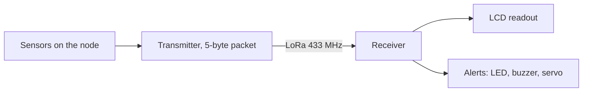

# Versatile Long-Range IoT Communication System (LoRa)

A long-range LoRa sensor link that sends air, soil and vibration readings from a field node to a receiver that shows them and raises alerts.

| | |
|---|---|
| Type | B.Tech minor project, 2025 |
| Radio | LoRa, 433 MHz, point to point |
| Builds | Industrial-style STM32F4 build, and an ATmega328P prototype (code in this repo) |
| Tested range | About 0.7 km (433 MHz prototype) |
| Use cases | Agricultural early-warning and landslide early-warning |
| Status | Prototype working. STM32F4 firmware not in this repo |

## Why it exists

Fields and hillsides are often outside Wi-Fi and mobile coverage. Soil temperature, soil moisture and ground vibration give early signs of crop stress and of unstable slopes. LoRa carries small readings a long way on very little power, so a node can sit in the field and report to a receiver far away.

## Two builds

**Industrial-style build (STM32F4).** This is the stronger build from an industrial point of view.

* STM32F4-based transmitter and receiver nodes using the LoRa E220 module for long-range, low-power communication
* Packet framing to keep telemetry reliable over a constrained bandwidth
* A DWIN HMI at the receiver for live data display and user interaction

It was built and tested. Its firmware is not in this repo.

**Prototype build (ATmega328P, Arduino, this repo).** The code here is the prototype. It uses the same idea on simpler hardware, and the range figure above was measured on it.

## How it works

The node reads five values and sends them in one packet, one byte each:

| Byte | Value |
|---|---|
| 1 | Air temperature |
| 2 | Humidity |
| 3 | Soil temperature |
| 4 | Soil moisture, percent |
| 5 | Vibration, percent |

The receiver shows the readings and raises an alert when soil temperature is above 30 degrees C or vibration is above 60 percent. An alert turns on the LED and buzzer and, for vibration, moves a servo.

## Hardware (prototype)

| Part | Role |
|---|---|
| ATmega328P (Arduino) | Transmitter and receiver controllers |
| LoRa module, 433 MHz | Radio link |
| DHT22 | Air temperature and humidity |
| DS18B20 | Soil temperature |
| Soil moisture sensor | Soil moisture |
| Vibration sensor | Ground vibration |
| SSD1306 OLED | Local display at the node |
| 20x4 I2C LCD | Display at the receiver |
| RGB LED, buzzer, servo | Alerts |

Main pins in the code:

| Signal | Pin |
|---|---|
| DHT22 | 6 |
| DS18B20 bus | 5 |
| Node LEDs: red, green, blue | 4, 3, 8 |
| Node buzzer | 7 |
| Receiver LEDs: red, green, blue | 4, 3, 5 |
| Receiver buzzer | 6 |
| Receiver servo | 7 |

## Run it

1. Install the Arduino IDE and these libraries: LoRa, DHT sensor library, Adafruit GFX, Adafruit SSD1306, OneWire, DallasTemperature, LiquidCrystal_I2C and Servo.
2. Wire the node and the receiver as listed above.
3. Upload `transmitter_original.ino` to the node.
4. Upload `receiver_original.ino` to the receiver.
5. Power both. The receiver starts showing readings once packets arrive.

## Limits and next steps

* The 0.7 km figure is from a single test with the 433 MHz prototype. It is not a rated range.
* Readings are sent as single bytes with no error check and no acknowledgement.
* Alert thresholds (30 degrees C, 60 percent) are fixed in the code.
* The soil moisture calibration values are hand-set for one sensor.
* The code uses direct LoRa between two nodes. It does not use LoRaWAN, a gateway or a network server.
* Next: publish the STM32F4 firmware, add acknowledgements, and log readings.

## Credits

B.Tech minor project at SRM Institute of Science and Technology, built by a team of three: Souparno, Vidip Singh Negi and Heemangshu Chattopadhyay.

## Licence

Not yet chosen.
